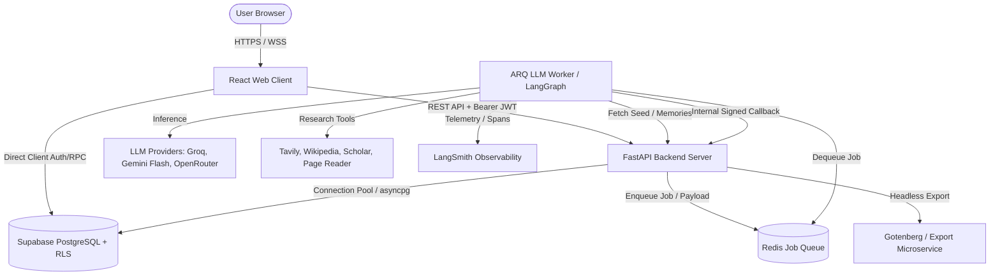
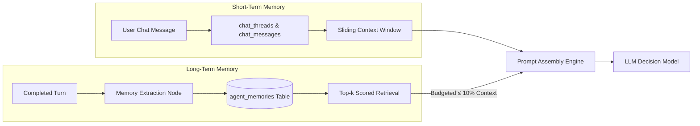

# Mind Map Generator — Architecture & System Design Notes

## 1. System Overview & Component Topology

The Mind Map Generator is architected as an asynchronous, decoupled, multi-tier system designed for reliability, strict data privacy, and predictable LLM token budgeting.

### Core Subsystems:
1. **Frontend Client (`frontend/`):** React 18, Vite, ReactFlow for interactive graph manipulation, dark-mode design system, and client-side HTML5 canvas fallback for exports.
2. **Backend Application (`backend/`):** FastAPI application handling authentication, map/node/edge persistence, URL seed SSRF validation, snapshot versioning, admin role-based APIs, and asynchronous Redis queue dispatch.
3. **LLM Orchestration Worker (`llm/`):** Standalone ARQ worker running LangGraph state graphs for multi-pass mind map generation, conversational chat elaboration, long-term memory extraction, and bounded research loops.
4. **Database & Storage Layer (`supabase/`):** PostgreSQL database with 11 tables protected by Row Level Security (RLS), atomic stored procedures (`.rpc()`), and private object storage for PDF/image seed assets.
5. **Observability Subsystem:** LangSmith tracing (`mindweave-dev` and `mindweave-prod`) capturing all LLM prompts, tool execution latencies, and token expenditures.

---

## 2. Search Maps Architecture (M3 / S2-DB4 / S2-FE5)

The application maintains a deliberate, two-tier architecture for searching user mind maps:

### Layer A: Direct Database RPC (`public.search_maps`)
- **Location:** `supabase/migrations/20261114000400_s2_db4_search_maps.sql`
- **Purpose:** PostgREST / Supabase Client direct access.
- **Security:** Security Definer with explicit ownership enforcement (`WHERE m.user_id = p_user_id AND (m.user_id = auth.uid() OR m.is_public = true)`).
- **Permissions:** Execution is granted to `authenticated` users only, with execution revoked from `anon` and `PUBLIC`.
- **Use Case:** Client-side dashboards querying Supabase directly using supabase-js client libraries.

### Layer B: FastAPI Backend Repository (`search_maps`)
- **Location:** `backend/db/repository.py`
- **Purpose:** Authoritative backend API search endpoint (`GET /api/maps?q=...&sort=...&offset=...`).
- **Features:**
  - High-performance direct asyncpg parameterized queries.
  - Comprehensive sorting options (`updated_at_desc`, `updated_at_asc`, `created_at_desc`, `created_at_asc`, `title_asc`, `title_desc`).
  - Full offset/cursor pagination with node count and generation job subquery aggregations.
  - Strict SQL injection protection via parameter binding and `replace()` escaping for `%` and `_` wildcards.
- **Use Case:** All REST API consumers querying through the FastAPI application server.

---

## 3. Asynchronous Execution & Webhook Callback Pattern

To avoid client timeouts during long generation runs (which involve multi-pass structuring and external research), the system decouples intake from generation:
1. **Intake:** The client submits a seed (`POST /api/maps/{id}/generate`). FastAPI persists a `generation_jobs` record in `pending` status, generates a cryptographic single-use callback token, and enqueues the payload to Redis via ARQ. The endpoint returns `HTTP 202 Accepted` immediately with a polling URL (`/api/maps/{id}/jobs/{job_id}`).
2. **Worker Processing:** The ARQ worker picks up the job, executes LangGraph nodes, calls research tools if applicable, and formats the output into a validated graph schema.
3. **Signed Callback:** Upon completion or error, the worker calls internal webhook routes (`POST /internal/jobs/{id}/complete` or `POST /internal/jobs/{id}/fail`) passing the bearer callback token. The backend verifies the token hash, transitions the job state to `completed` or `failed`, persists the nodes/edges atomically, and marks the job finished.
4. **Smooth Polling:** The frontend polls every 1 second, updating the progress bar until completion, then renders the fresh graph without requiring Server-Sent Events (SSE) overhead.

---

## 4. Conversational Assistant & Memory Architecture

1. **Short-Term Conversational Memory (Sprint 2):** Scoped strictly per mind map via `chat_threads` and `chat_messages` tables. Maintains recent turns within a token-managed sliding window. Includes document excerpting (`format_seed_content`) to prevent context blowup.
2. **Long-Term Agent Personalization (Sprint 3 — S3-DB2, S3-BE4, S3-L3):**
   - After each chat turn or generation, an extraction node identifies durable user preferences, past decisions, and project facts.
   - Memories are proposed to the backend via `POST /internal/memory/propose` and stored in `agent_memories`.
   - During prompt assembly, top-k relevant memories are retrieved and injected into the prompt under a strict token budget ($\le 10\%$ of total context).
   - Protected by RLS: users see only their own memories; administrators have zero SELECT access.

---

## 5. Dynamic Context & Token Budgeting (`S3-L7`)

To guarantee prevention of `HTTP 413 (Payload Too Large)` and `HTTP 429 (Rate/Token Quota Exceeded)` errors across various LLM providers:
- **`ContextBudgetManager`:** Dynamically calculates token slots for system prompts, seed excerpts, long-term memory, RAG passages, and chat history.
- **Provider-Aware Limits:** Scales context limits according to the active provider (Groq 8k/6k input ceiling, Qwen OTPM clamp, Gemini Flash 32k/128k).
- **Hierarchical Pruning:** When context exceeds the target limit, items are trimmed in strict priority order:
  1. Lowest-scoring RAG chunks.
  2. Oldest chat messages outside the sliding window.
  3. Dense external tool payloads (Wikipedia, Page Reader, Scholar).

---

## 6. Observability Subsystem (`S3-OBS`)

- **Instrumentation:** All LangGraph nodes, research subgraphs, and tool calls are decorated with `@traceable`.
- **Environment Isolation:** Traces are partitioned into `mindweave-dev` and `mindweave-prod` LangSmith projects.
- **Automated Evaluations:** Quality-gate benchmark seeds (node count, graph depth, schema validity, latency) run against evaluation datasets and report directly to the LangSmith dashboard.
- **Zero-Secret CI:** Tracing gracefully falls back to a clean no-op when `LANGCHAIN_TRACING_V2` is absent, guaranteeing hermetic, deterministic CI test execution.

---

## 7. Platform Administration & Privacy Boundary (`S3-DB1`, `S3-BE1-3`, `S3-FE1`)

- **Role-Based Access Control:** User roles are maintained in `profiles.role` (`user` vs `admin`, default `user`). Administrative routes are guarded by FastAPI's `require_admin_role()`.
- **Audit Logging:** Every administrative write (suspend, unsuspend, delete) appends an unalterable record to `admin_audit_log`.
- **Zero-SELECT Privacy Rule:** Administrators have access to aggregate platform metrics only (total users, active maps, failure rates). PostgreSQL RLS and database views guarantee that administrators have **no SELECT permissions** on private user content tables (`mind_maps`, `nodes`, `edges`, `chat_messages`, `agent_memories`).

---

## 8. Scope Decision: Single-Owner Architecture vs. Multi-User Collaboration

> [!IMPORTANT]
> **Descoping of Multi-User Collaboration in Sprint 3:**
> - Multi-user real-time concurrent editing and conflict synchronization (FR-20 to FR-25) were evaluated and **officially descoped** due to extreme architectural complexity (Operational Transformation / CRDTs), distributed state synchronization overhead, and strict sprint deadlines.
> - The application is deliberately architected as a **single-owner system**: each mind map belongs to exactly one user (`mind_maps.user_id`), enforced immutably via database triggers and RLS.
> - Single-owner multi-tab concurrency is protected via optimistic version token checks (`If-Match` / `expected_version`) and window focus revalidation, preventing accidental overwrites.
